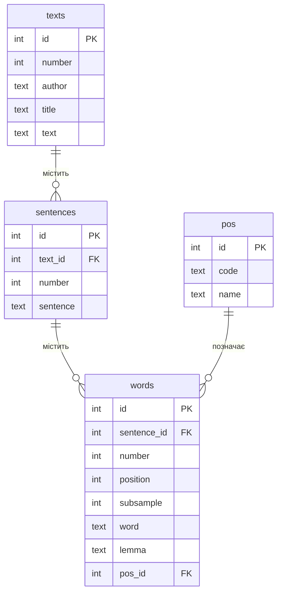

# Звіт до лабораторної роботи «Автоматичне укладання частотних словників»

**Виконала:** ____________________

**Мета роботи:** для кількох художніх текстів автоматично укласти частотні словники словоформ, лем і частин мови в реляційній базі даних SQLite та обчислити статистичні характеристики агрегуючими SQL-запитами (`SELECT … COUNT(…) … GROUP BY`) з урахуванням повторів слів.

**Засоби:** Python 3, `tokenize_uk` (токенізація), `pymorphy3` зі словником ВЕСУМ (лематизація і частиномовне анотування), `sqlite3` (база даних), `scikit-learn` (TF-IDF, кластеризація). Код: `main.py`, запити: `queries.py`, база: `output/freq_dict.db`.

---

## І. Вступна частина

### 1.1. Лінгвістична однорідність вибірок

| № | Автор | Твір | Жанр | Видання | Джерело |
| --- | --- | --- | --- | --- | --- |
| 1 | Іван Франко | «Захар Беркут» (1883) | історична повість | Франко І. Твори, 1956–1962, т. 13 | [Вікіджерела](https://uk.wikisource.org/wiki/Твори_(Франко,_1956–1962)/13/Захар_Беркут) |
| 2 | Іван Франко | «Перехресні стежки» (1900) | соціально-психологічна повість | Франко І. Твори, 1956–1962, т. 12 | [Вікіджерела](https://uk.wikisource.org/wiki/Твори_(Франко,_1956–1962)/12) |
| 3 | Михайло Коцюбинський | «Fata Morgana» (1903–1910) | соціально-психологічна повість | Коцюбинський М. Твори, 1955, т. 2 | [Вікіджерела](https://uk.wikisource.org/wiki/Твори_(Коцюбинський,_1955)/2/Fata_Morgana) |

Вибірки однорідні за такими параметрами:

- **стиль:** художній;
- **жанр:** повість (велика епічна проза);
- **період:** українська проза кінця XIX — початку XX ст.;
- **правопис:** усі тексти взято з радянських академічних видань 1950-х років, тобто в єдиній нормалізованій орфографії.

Відмінні параметри дають змогу порівнювати вибірки:

- **автор:** Франко і Коцюбинський;
- **тематика:** історична («Захар Беркут»), міська й адвокатська («Перехресні стежки»), сільська («Fata Morgana»).

### 1.2. Статистична однорідність вибірок

| Параметр | Значення |
| --- | --- |
| Метод організації вибірки | механічний: суцільний фрагмент від початку твору |
| Обсяг кожної вибірки | 20 000 слововживань після токенізації |
| Кількість підвибірок | 20 по 1000 слововживань |
| Загальний обсяг | 60 000 слововживань |

Вихідні тексти мали більше слів, ніж потрібно: 39 078, 32 292 і 30 002. Після токенізації `tokenize_uk` і відкидання чисел та розділових знаків кожну вибірку обрізано рівно до 20 000 слововживань. Отже, умова методички про збільшення обсягу до 20 тисяч у разі втрат під час токенізації виконана.

**Достатність обсягу** оцінено за відносною похибкою частоти одиниці:

> δ = t · √((1 − p) / (p · N)), де t = 1,96 (надійність 95 %), p — імовірність одиниці, N = 20 000.

Межі оцінки: δ ≤ 10 % — висока точність, δ ≤ 33 % — обсяг достатній, δ > 33 % — обсягу недостатньо. З цієї формули обсяг достатній (δ ≤ 33 %) для одиниць з абсолютною частотою **не менше 36** у вибірці.

| Текст | Частин мови з δ ≤ 10 % | Частин мови з δ ≤ 33 % | Лем із частотою ≥ 36 | Усього лем |
| --- | --- | --- | --- | --- |
| Захар Беркут | 8 | 11 | 82 | 4 210 |
| Перехресні стежки | 8 | 14 | 74 | 4 244 |
| Fata Morgana | 8 | 12 | 72 | 4 209 |

Обсяг 20 000 слововживань достатній для статистики частин мови. Для статистики окремих лем він достатній лише для 72–82 найчастотніших лем кожного тексту.

---

## ІІ. Основна частина: опис укладання частотних словників

### 2.1. Обробка тексту

1. **Нормалізація:** уніфікація апострофів (`’`, `ʼ` → `'`), вилучення знаків наголосу та м'яких переносів.
2. **Токенізація:** `tokenize_uk.tokenize_sents` поділяє абзац на речення, `tokenize_uk.tokenize_words` — речення на слова. Словом вважається токен, що починається з літери; числа й розділові знаки відкидаються.
3. **Лематизація і частиномовне анотування:** `pymorphy3.MorphAnalyzer(lang="uk")`. Це сумісний наступник `pymorphy2`, який не працює на Python 3.11+. Аналізатор використовує той самий словник ВЕСУМ.
4. **Корекція службових слів.** Аналізатор вибирає розбір без урахування контексту і часто помиляється на найчастотніших словах: «його» → лема «йога», «вона» → «вон», «мені» → «мен», «до» → іменник. Для 214 таких форм уточнений розбір задано в `data/morphology_overrides.json`.
5. **Поділ на підвибірки:** номер підвибірки = ⌊позиція слова / 1000⌋ + 1.

Приклад токенізації, лематизації та частиномовного анотування (речення з «Захара Беркута»):

> «Але все інше якже змінилося!»

| Словоформа | Лема | Частина мови |
| --- | --- | --- |
| але | але | Сполучник |
| все | все | Займенник |
| інше | інший | Займенник |
| якже | якже | Прислівник |
| змінилося | змінитися | Дієслово |

### 2.2. Структура бази даних

Основа — рекомендована [ER-модель](https://drawsql.app/teams/infosoft-1/diagrams/text-structure-parsing) `texts → sentences → words → pos`. Кожне слововживання зберігається окремим рядком таблиці `words`, тому **повтори слів не втрачаються**: слово, що трапилося 727 разів, займає 727 рядків.



Частотні словники формуються з цієї структури автоматично, агрегуючими запитами:

| Таблиця | Відповідник у методичці | Як утворена |
| --- | --- | --- |
| `freq_forms` | Варіант 1: БД_ЧС_словоформ | `GROUP BY text_id, wordform` |
| `freq_wordforms` | Варіант 2: ЧС із лемою і частиною мови | `COUNT(*)`, `SUM(subsample = k)` з `words` |
| `freq_lemmas` | БД_ЧС_лем | `SUM` з `freq_wordforms`, `GROUP BY lemma` |
| `freq_pos` | БД_ЧС_ЧМ | `SUM` з `freq_wordforms`, `GROUP BY pos` |
| `pos_statistics` | базові статистичні характеристики | середнє, σ, варіація, похибки |
| `tfidf` | TF-IDF | формула в SQL і перевірка scikit-learn |

Кожна частотна таблиця містить абсолютну частоту у вибірці (`abs_freq`) і частоти у 20 підвибірках (`part_1` … `part_20`). Приклад рядка з `freq_lemmas`: лема «громада» в «Захарі Беркуті» має абсолютну частоту 151 і 10 різних словоформ (громада, громади, громаді, громад, громаду…).

Коректність бази перевіряють 13 автоматичних тестів (`tests/test_integrity.py`):

- у кожній вибірці рівно 20 000 слововживань, у кожній підвибірці рівно 1000;
- сума частот у кожному частотному словнику дорівнює обсягу вибірки, тобто жоден повтор не втрачено;
- сума `part_1…part_20` дорівнює `abs_freq` у кожному рядку;
- значення TF-IDF відповідають формулі;
- зовнішні ключі цілісні.

---

## ІІІ. Результати

### 3.1. Загальні показники

| Текст | Словоформ | Лем | Речень | Сер. довжина речення | Сер. довжина слова | Лекс. багатство | Гапакси, % |
| --- | --- | --- | --- | --- | --- | --- | --- |
| Захар Беркут | 6 569 | 4 210 | 1 224 | 16,34 | 4,98 | 0,3285 | 67,83 |
| Перехресні стежки | 6 302 | 4 244 | 1 586 | 12,61 | 4,81 | 0,3151 | 69,95 |
| Fata Morgana | 6 630 | 4 209 | 2 552 | 7,84 | 4,69 | 0,3315 | 67,39 |

*Лексичне багатство* — частка різних словоформ серед усіх слововживань. *Гапакси* — словоформи, що трапилися лише один раз.

### 3.2. Кількість частин мови

Запит:

```sql
SELECT text_id, pos, COUNT(*) AS freq
FROM tokens
GROUP BY text_id, pos
ORDER BY text_id, freq DESC;
```

| Частина мови | Захар Беркут | % | Перехресні стежки | % | Fata Morgana | % |
| --- | --- | --- | --- | --- | --- | --- |
| Іменник | 5 663 | 28,32 | 4 773 | 23,86 | 5 701 | 28,50 |
| Дієслово | 2 897 | 14,48 | 3 437 | 17,18 | 4 073 | 20,36 |
| Займенник | 2 797 | 13,98 | 3 362 | 16,81 | 2 261 | 11,30 |
| Сполучник | 2 100 | 10,50 | 2 070 | 10,35 | 2 212 | 11,06 |
| Прийменник | 2 009 | 10,04 | 1 881 | 9,40 | 1 843 | 9,21 |
| Прикметник | 1 579 | 7,89 | 1 094 | 5,47 | 1 037 | 5,18 |
| Прислівник | 1 195 | 5,97 | 1 377 | 6,88 | 1 297 | 6,49 |
| Частка | 1 017 | 5,08 | 1 293 | 6,46 | 1 132 | 5,66 |
| Дієприкметник | 306 | 1,53 | 150 | 0,75 | 190 | 0,95 |
| Дієприслівник | 225 | 1,13 | 187 | 0,94 | 54 | 0,27 |
| Числівник | 166 | 0,83 | 191 | 0,95 | 103 | 0,52 |
| Вигук | 17 | 0,09 | 79 | 0,40 | 54 | 0,27 |
| Присудкове слово | 26 | 0,13 | 50 | 0,25 | 34 | 0,17 |
| Іншомовне | 0 | 0 | 48 | 0,24 | 0 | 0 |
| Невизначено | 3 | 0,01 | 8 | 0,04 | 9 | 0,04 |

Похідні показники:

| Показник | Захар Беркут | Перехресні стежки | Fata Morgana |
| --- | --- | --- | --- |
| Дієслово / Іменник | 0,51 | 0,72 | 0,71 |
| Прикметник / Іменник | 0,28 | 0,23 | 0,18 |

### 3.3. Статистичні характеристики частин мови у 20 підвибірках

Для основних частин мови (x̄ — середня частота в підвибірці, σ — стандартне відхилення, V = σ / x̄ — коефіцієнт варіації, δ — відносна похибка за всією вибіркою):

| Частина мови | Захар Беркут: x̄ / V / δ | Перехресні стежки: x̄ / V / δ | Fata Morgana: x̄ / V / δ |
| --- | --- | --- | --- |
| Іменник | 283,2 / 0,08 / 2,2 % | 238,7 / 0,14 / 2,5 % | 285,1 / 0,08 / 2,2 % |
| Дієслово | 144,9 / 0,15 / 3,4 % | 171,9 / 0,10 / 3,0 % | 203,7 / 0,08 / 2,7 % |
| Займенник | 139,9 / 0,27 / 3,4 % | 168,1 / 0,21 / 3,1 % | 113,1 / 0,18 / 3,9 % |
| Прикметник | 79,0 / 0,27 / 4,7 % | 54,7 / 0,31 / 5,8 % | 51,9 / 0,20 / 5,9 % |
| Вигук | 0,9 / 1,34 / 47,5 % | 4,0 / 0,89 / 22,0 % | 2,7 / 0,79 / 26,6 % |

Повна таблиця — `output/csv/11_pos_statistics.csv`.

### 3.4. TF-IDF

TF-IDF обчислено для лем: TF = частота леми / 20 000, IDF = ln(N / df), де N = 3 (кількість текстів), df — кількість текстів, у яких трапляється лема. Обчислення виконано SQL-запитом (функцію `LN` зареєстровано в SQLite через Python) і перевірено за `TfidfVectorizer` зі scikit-learn.

Ключові повнозначні леми з найвищим TF-IDF:

| Ранг | Захар Беркут | Перехресні стежки | Fata Morgana |
| --- | --- | --- | --- |
| 1 | боярин | стальський | маланка |
| 2 | тухольський | євгеній | андрій |
| 3 | тугар | меценас | гафійка |
| 4 | захар | рафалович | хома |
| 5 | князь | вагман | гуральня |
| 6 | беркут | панночка | підпара |
| 7 | мирослава | помешкання | вогонь |
| 8 | максим | лихвар | прокіп |
| 9 | вовк | президент | гуща |
| 10 | звіря | повіт | панас |
| 11 | княжий | адвокат | гудзь |
| 12 | монгол | канцелярія | марко |

Із 9 469 різних лем корпусу у всіх трьох текстах трапляються лише 795. Для них IDF = ln(3/3) = 0, тож вони не мають ваги для розрізнення текстів. Це переважно службові слова і загальновживана лексика: «бути», «знати», «рука», «око».

### 3.5. Інші показники

**Частотний спектр словоформ**:

| Абс. частота | Захар Беркут: словоформ / слововживань | Перехресні стежки | Fata Morgana |
| --- | --- | --- | --- |
| 1 | 4 456 / 4 456 | 4 408 / 4 408 | 4 468 / 4 468 |
| 2 | 937 / 1 874 | 874 / 1 748 | 956 / 1 912 |
| 3–5 | 690 / 2 482 | 598 / 2 193 | 738 / 2 647 |
| 6–20 | 375 / 3 486 | 313 / 3 124 | 370 / 3 502 |
| 21–100 | 94 / 3 773 | 92 / 4 124 | 84 / 3 592 |
| 101+ | 17 / 3 929 | 17 / 4 403 | 14 / 3 879 |

**Розподіл речень за довжиною** (кількість речень):

| Слів у реченні | Захар Беркут | Перехресні стежки | Fata Morgana |
| --- | --- | --- | --- |
| 1–5 | 155 | 465 | 1 214 |
| 6–10 | 309 | 410 | 707 |
| 11–20 | 428 | 430 | 492 |
| 21–30 | 191 | 160 | 120 |
| 31+ | 141 | 121 | 19 |

**Спільна лексика (коефіцієнт Жаккара для множин лем)**:

| Пара текстів | Спільних лем | Жаккар |
| --- | --- | --- |
| Захар Беркут — Перехресні стежки | 1 407 | 0,1997 |
| Захар Беркут — Fata Morgana | 1 297 | 0,1821 |
| Перехресні стежки — Fata Morgana | 1 285 | 0,1793 |

**Кластеризація.** 60 підвибірок (по 20 з кожного тексту) подано як TF-IDF-вектори повнозначних лем і розбито алгоритмом KMeans на 3 кластери. Кожен кластер зібрав усі 20 підвибірок одного твору, жодна підвибірка не потрапила до чужого.

---

## IV. Висновки

1. **Частотні словники укладено автоматично.** Для трьох вибірок по 20 000 слововживань (60 000 разом) побудовано реляційну базу на основі рекомендованої ER-моделі. Частотні словники словоформ (обидва варіанти методички), лем і частин мови з розподілом за 20 підвибірками сформовано SQL-запитами `SELECT … COUNT/SUM … GROUP BY`. Повтори слів збережено: кожне слововживання — окремий рядок, а суми частот у всіх словниках дорівнюють обсягу вибірки, що підтверджують автоматичні тести.

2. **Іменник — найчастотніша частина мови в усіх текстах** (23,9–28,5 %). Далі йдуть дієслово (14,5–20,4 %) і займенник (11,3–16,8 %). Службові частини мови (сполучник, прийменник, частка) разом становлять близько 25 % кожного тексту, і їхня частка між текстами майже не змінюється (сполучники 10,4–11,1 %, прийменники 9,2–10,0 %). Це підтверджує жанрову однорідність вибірок.

3. **Частиномовний склад відображає стиль твору.**
   - «Захар Беркут» — найбільш «іменний» і описовий текст: найнижче відношення дієслів до іменників (0,51), найбільше прикметників (7,9 %), дієприкметників і дієприслівників. Тут же найдовші речення (16,3 слова) і найдовші слова. Це відповідає епічному стилю історичної повісті з розлогими описами природи й промовами на громадській раді.
   - «Перехресні стежки» мають найбільшу частку займенників (16,8 %), вигуків і іншомовних вставок (латинь, німецька, польська). Це наслідок великої кількості діалогів, внутрішнього мовлення і мови галицької інтелігенції.
   - «Fata Morgana» — найбільш «дієслівний» текст (20,4 % дієслів) з найкоротшими реченнями (7,8 слова): майже половина речень (1 214 із 2 552) має до п'яти слів. Це динамічна, драматизована розповідь із короткими репліками.

4. **TF-IDF виявляє тематику та персонажів.** Найвищу вагу мають імена героїв (Захар, Тугар, Мирослава; Євгеній Рафалович, Стальський; Маланка, Андрій, Гафійка) і тематичні слова: «боярин», «князь», «монгол» (історична тематика); «меценас», «адвокат», «канцелярія», «лихвар», «повіт» (судово-адміністративне середовище); «гуральня», «підпара», «піч» (село). Оскільки текстів три, IDF набуває лише трьох значень: 1,0986, 0,4055 і 0. Тому для ранжування вирішальним є TF, а 795 спільних для всіх текстів лем отримують нульову вагу.

5. **Лексичні показники вибірок близькі.** Лексичне багатство становить 0,32–0,33, гапакси — 67–70 % словоформ. Невелика кількість найчастотніших словоформ покриває значну частину тексту: 14–17 словоформ із частотою понад 100 дають 19–22 % усіх слововживань. Це узгоджується з типовим для природної мови розподілом частот (закон Ципфа).

6. **Автор впливає на лексику.** Два твори Франка мають найбільший коефіцієнт Жаккара (0,1997) порівняно з парами з Коцюбинським (0,18), хоча тематично «Захар Беркут» і «Перехресні стежки» дуже різні.

7. **Тексти статистично різні за лексикою.** Кластеризація KMeans за TF-IDF без помилок розподілила 60 підвибірок за трьома творами. Отже, навіть фрагмент у 1000 слововживань несе достатньо лексичної інформації, щоб визначити твір.

8. **Достатність обсягу.** Для основних частин мови відносна похибка не перевищує 6 % (висока точність), а коефіцієнт варіації в підвибірках малий (іменник V = 0,08–0,14). Отже, обсяг 20 000 слововживань достатній для частиномовної статистики. Для рідкісних класів (вигук, присудкове слово) похибка перевищує 33 %. Для лем обсяг достатній лише для 72–82 найчастотніших лем кожного тексту (частота ≥ 36). Для повноцінного словника лем вибірку треба збільшувати.

9. **Обмеження методу.** Морфологічний аналізатор вибирає розбір без урахування контексту. Найчастотніші помилки службових слів виправлено словником уточнень, але в омонімах можливі поодинокі помилки: наприклад, «на старому житлі» → «старе» (іменник), «заросла» → дієприкметник замість дієслова. Частка нерозпізнаних слів мізерна — 0,01–0,04 %. Власні назви зведено до нижнього регістру. У вихідному тексті «Перехресних стежок» у Вікіджерелах позначено пропуск двох сторінок.
